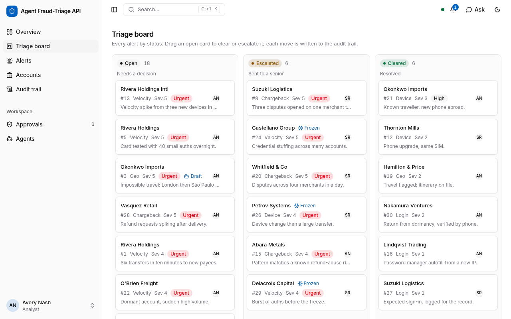

# Agent Fraud-Triage API

One governed Xano API a fraud team's analysts and their AI agents both call, where the same authority rules decide every action and one audit trail records every attempt, allowed or refused.

**Enterprise template · Play 4: Agent Intelligence Layer · Financial services / fraud operations**

`4 domain tables · 14 domain endpoints · 6 screens · auth: @xano-sdk/auth (ejected)`



A fraud analyst and the analyst's AI agent hit the **same** permissioned, logged endpoints. Clearing and escalating an alert is in scope for both. Freezing an account is senior-only, so an analyst (and the analyst's agent) is refused at the API layer with the deciding rule, and the refusal is written to the audit trail just like an allowed action. The agent never exceeds its person: it acts on the connecting analyst's role, and anything it cannot do directly it can only recommend, which a senior approves in the app.

## Quick start

```bash
git clone https://github.com/xano-scratch/agent-fraud-triage-api
cd agent-fraud-triage-api
npm install
```

Then run it one of two ways:

```bash
npm run xano:deploy    # deploys and seeds the backend on the Xano Engine on your machine, no account
npm run dev            # opens the app, already pointed at it
```

Or for a cloud link that works with ChatGPT and Claude:

```bash
npx xanosdk login              # once
npm run xano:deploy:ephemeral  # a live ephemeral URL
```

Then open the app and click **Continue as Avery (analyst)**.

## What you can do

**As Avery (analyst):**
1. On the **Triage board**, drag a high-severity alert from **Open** to **Escalated**. It moves at once, a toast confirms, and a new line appears in the **Audit trail**.
2. Open an account and try **Freeze**. You are refused: "Freezing an account requires senior authority." Open the **Audit trail** and the refused attempt is there, with the deciding rule.
3. Add a finding to an alert, or open one and clear it. Both are allowed and audited.

**As Sloan (senior), in a second window:**
4. **Freeze** the same account. It goes to frozen, audited as allowed, and the account's open-alert assignees are notified. Avery's board and accounts update live, with no reload.
5. Change a role or edit an account's risk note. Both are senior-only.

Open a second window as the other person to watch a change arrive live. Invite a teammate from **Team**: the link signs them in with the role you pick.

## Connect your agent

Your agent calls the same guarded endpoints you do, as you, within your role.

1. Sign in, open **Agents**, and pick your agent.
2. Coding agents (Claude Code, Cursor, VS Code, Codex, Windsurf): create a read-and-write key, then run the one command or click the one link.
3. ChatGPT and Claude (web and desktop): add the sign-in URL as a connector, sign in with your own account, and choose Allow. Demo personas have no password, so sign up for an account first.

The tools it gets:

| Tool | Does | Access | Asks a person first? |
|---|---|---|---|
| `list_open_alerts` | The open queue, most severe first | read | no |
| `get_alert` | One alert with its account and findings | read | no |
| `search_accounts` | Find an account by holder or number | read | no |
| `triage_alert` | Drafts a clear or escalate | read-write | yes, the analyst approves |
| `add_finding` | Adds a finding, logged as an agent action | read-write | no |
| `recommend_freeze` | Drafts a freeze recommendation | read-write | yes, a senior approves |

Your agent can draft a triage or a freeze, but a person approves it first under **Approvals**. `add_finding` runs directly and is logged with the agent's name. Revoke a key, or sign out signed-in agents, on the **Agents** page. Every call lands in the agent activity feed.

For a self-hosted copy: after the first cloud deploy, set `MCP_OAUTH_LOGIN_URL` (see "Going to production"), or ChatGPT and Claude cannot connect.

## Built in

Every screen already has the things people expect from an app made in 2026, the same in this app as in any other built this way:

- **Live updates.** When a person, their agent, or the assistant changes an alert, an account, or the audit trail, every open screen shows it, and the header shows who else is here.
- **Notifications.** A bell with an unread count. An escalation tells the seniors; a freeze tells the account's assignees and the seniors.
- **⌘K and shortcuts.** Find any alert (by reason) or account (by holder or number) from the keyboard. Press `?` for the full list.
- **The assistant.** Opened from the header's **Ask**. It summarises the queue, finds alerts, and drafts a triage for you to approve.
- **Invites and password resets**, settings, a profile, and an activity history, all without a mail service.

## How auth works

This template starts from [`@xano-sdk/auth`](https://github.com/xano-sdk/auth), ejected into the app's own source under `xano/`, so the user table, the roles, and the demo sign-in are the app's to shape. Authorization is enforced at the API layer, in the guards in each endpoint's stack. It is not row-level security.

Two roles:

| Role | Can | Cannot |
|---|---|---|
| `analyst` | Triage alerts (clear, escalate, add findings), read the audit trail, recommend a freeze | Freeze or unfreeze accounts, manage the team |
| `senior` | Everything an analyst can, plus freeze and unfreeze accounts, edit an account's risk note, and manage the team | Not restricted |

The permission map lives in one file, `xano/rbac.ts`, and the endpoint guards, the shared rule path, the agent and assistant tools, the approvers, and the UI all read it. Seniors change roles under **Team**, and every change is recorded.

The one place that reads differently on purpose is the freeze endpoint. It is guarded by `alerts.triage`, not `accounts.freeze`, so an analyst **reaches** the shared rule path and is refused there, with the refusal written to the audit trail. The `accounts.freeze` check lives in `apply_action`, the one function every write path runs through. That is what makes "every attempt is audited" true for a person and an agent alike.

Demo sign-in is one click per role, through `auth/demo`, which mints a token only for a seeded demo person. The shared demo password is in `xano/table/user.ts` and never reaches the frontend. Tokens last 24 hours by default.

## API surface

All domain endpoints are in the `api` group, authenticated with the user's token.

| Verb and path | Who may call it | What it enforces |
|---|---|---|
| `GET api:alerts` | `alerts.triage` | Queue list; filters status, severity (minimum), kind, reason, and "assigned to me"; paged, severity first |
| `GET api:alerts/{id}` | `alerts.triage` | One alert with its account, findings, and audit events; 404 if missing |
| `POST api:alerts/{id}/act` | `alerts.triage` | Clear or escalate an open alert, through `apply_action`; audited |
| `POST api:alerts/{id}/findings` | `alerts.triage` | Append a finding (non-blank, under 500 characters); audited |
| `POST api:alerts` | `alerts.triage` | Open a manual alert; validates the account and severity 1 to 5 |
| `PATCH api:alerts/{id}` | `alerts.triage` | Edit severity, reason, or assignee on an open alert |
| `GET api:accounts` | `alerts.triage` | Accounts list; filters status and holder; paged |
| `GET api:accounts/{id}` | `alerts.triage` | One account with its alerts and freeze state |
| `PATCH api:accounts/{id}` | `accounts.freeze` | Edit an account's risk note |
| `POST api:accounts/{id}/freeze` | `alerts.triage` to attempt | `apply_action` requires `accounts.freeze`; an analyst is refused 403 and the refusal is audited; a senior freezes |
| `POST api:accounts/{id}/unfreeze` | `alerts.triage` to attempt | The senior-only reverse, same rule path |
| `GET api:audit` | `audit.read` | The trail, newest first; filters action, allowed or refused, actor kind, alert, account |
| `GET api:settings` | any signed-in | The urgent-severity threshold |
| `PATCH api:settings` | `team.manage` | Set the urgent-severity threshold (1 to 5) |

Plus the base app's own auth, RBAC, agent, approvals, and assistant endpoints.

## Repo layout

The app's own files:

- `xano/app.ts` (name, roles, demo people, seed activity), `xano/rbac.ts` (the permission map), `xano/approvals.ts` (the two approval actions).
- `xano/table/*.ts` (the four domain tables), `xano/function/*.ts` (`load_actor`, `apply_action`, and the two approval action functions), `xano/query/api/*.ts` (the endpoints), `xano/query/agent/mcp.ts` (the agent tools), `xano/query/assistant-tools.ts`, `xano/domain.ts` (registers them all).
- `frontend/src/app.config.tsx` (screens, nav, ⌘K, the assistant), `frontend/src/lib/` (the typed API and shared helpers), `frontend/src/pages/` (the six screens).

The base app, shared by every template built this way, and not edited per app: `xano/base/`, `frontend/src/base/`, and `frontend/src/components/kit/`.

## Extend it

- **Add an alert kind.** Add it to the `kind` enum in `xano/table/alert.ts`, give it a label in `frontend/src/lib/triage.tsx` (`KIND_LABELS`), and re-deploy.
- **Add a reviewer role.** Add it to `ROLES` in `xano/app.ts`, give it permissions in `xano/rbac.ts`, and add a demo person so a visitor can try it.
- **Add an action to the trail.** Add a branch to `apply_action` (`xano/function/actor.ts`), add its value to the `audit_event.action` enum, and it shows up on the Audit trail with its deciding rule.

## Going to production

- Remove the demo personas (delete the `demo_persona` rows) and the demo users, and remove the shared demo password from `xano/table/user.ts`.
- Set a real token expiry on the user table.
- After the first cloud deploy, set the sign-in URL so ChatGPT and Claude can connect: `npx xanosdk env set MCP_OAUTH_LOGIN_URL "<your backend URL>/api:mcp-oauth-agent-fraud-triage-api/mcp_oauth/login"`.
- Cut a release: `npx xanosdk release create <name>`, then `npx xanosdk promote <release>`.

## What it demonstrates

This is the **Agent Intelligence Layer** play. The business rule that matters, who may freeze a customer account, lives once in `apply_action`, a single governed function that a person's REST request and an agent's approved action both run through. An evaluator can point at that one function and the permission map beside it and see exactly what is enforced, for a person and for an agent, with a trail that records the refusals as well as the approvals. There is no separate agent path to keep in sync, and no rule that lives only in the README.

## FAQ

**Does the agent have its own login?** Yes. An agent gets a scoped, expiring, revocable key from the **Agents** page, stored in a separate `agent_connection` table. It is never the person's session token, and a human endpoint refuses it.

**What happens if I approve an agent's freeze after being demoted?** The action re-checks your role when it runs, not when the agent asked, so a demoted senior can no longer approve it and the request keeps waiting.

**Is the data real?** It is seed data, generated fresh on every deploy, with dates relative to the deploy day. Re-deploying re-seeds it cleanly.

**Can I run it without a Xano account?** Yes. `npm run xano:deploy` runs the backend on the Xano Engine on your machine. A cloud deploy is only needed for the ChatGPT and Claude sign-in connectors.
